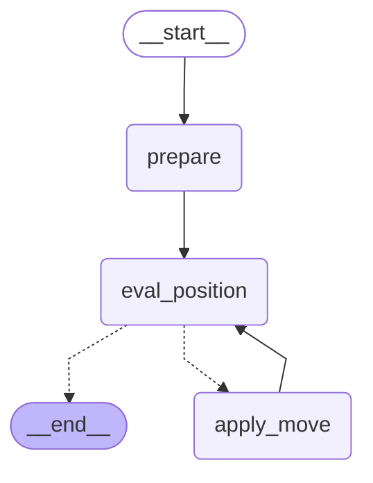
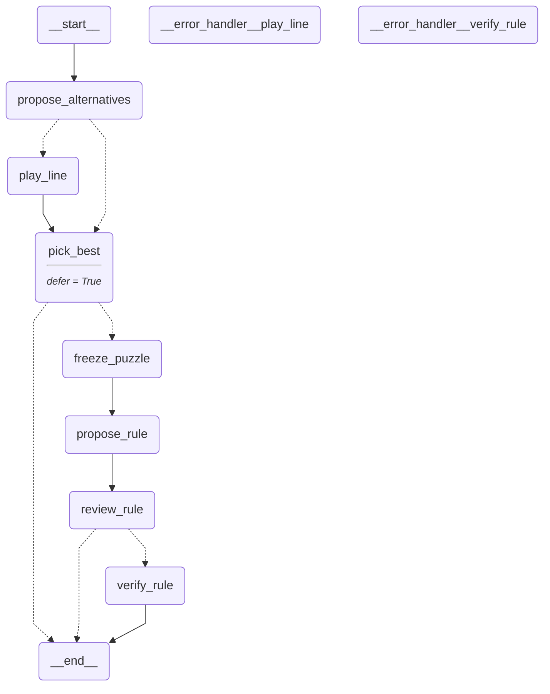

# Architecture

sessionfish is two LangGraph `StateGraph`s and a small amount of glue in `review.py`. Every
decision (what a position is worth, which moves are bad, which alternative is best, whether a
rule works) is made by code. The model is consulted in three places only: proposing alternative
lines, proposing a CLAUDE.md rule, and continuing a puzzle position.

## Modules

| Module | Kind | What it does |
| --- | --- | --- |
| `transcript.py` | code | Claude Code JSONL → plies. Dedupes `usage` across split message lines, expands `MultiEdit`, relativizes paths to the session cwd. |
| `moves.py` | schema | The tool vocabulary (`Read`, `Edit`, `Write`, `Bash`) as a pydantic discriminated union, shared by recorded and proposed moves. `Line` caps depth at 5, `Alternatives` at 3 lines. |
| `hook.py` | code | `SessionStart` hook: HEAD sha + patch of tracked and untracked changes. |
| `scratch.py` | code | `git clone --shared` scratch checkouts, tree hashes, restore a tree, diffs. |
| `replay.py` | code | Applies one move. Bash is never executed: allowlisted pytest/ruff are `noop`, anything else is `unreplayable`. |
| `evaluate.py` | code | Runs pytest (JUnit XML), ruff, optional mypy; scores the position against the base. |
| `annotate.py` | code | Win chance, sustained drop over the recovery window, `??`/`?`/`?!`, motifs, accuracy. |
| `game.py` | graph | The GAME graph, game-record extraction from checkpoint history, forking. |
| `analysis.py` | graph | The ANALYSIS graph and rule verification. |
| `review.py` | glue | Runs both graphs, freezes puzzles, writes reports. |
| `report.py`, `viewer.py` | output | Markdown and the self-contained HTML viewer. |
| `redact.py` | code | Secrets and home paths scrubbed from everything written out. |

## GAME graph

<!-- game-graph:start -->

<!-- game-graph:end -->

One thread per session. Each move is one loop iteration (`apply_move` then `eval_position`), so
each position is the checkpoint written after `eval_position`. `main_line()` walks the parent
chain of the final checkpoint through `get_state_history()`: there is no separate record to keep
in sync.

**Cache.** `eval_position` has `CachePolicy(key_func=eval_cache_key)` and the graph is compiled
with an `InMemoryCache`. The key is the git tree hash plus a digest of the eval settings. Reads,
test runs and unreplayable commands do not change the tree, so they cost nothing, and alternative
lines that reach a known tree reuse it. One subtlety: a cache hit replays *all* writes of the
cached run, including the routing of the conditional edge after the node. The key therefore also
carries whether moves remain; otherwise a cached "go to `apply_move`" would be replayed on the
last ply.

**Tokens** are not a property of the tree, so the token penalty is added after the cache, when
the record is read.

## Scoring

Scores are centipawn-like, relative to the base position, positive is good. Defaults
(`evaluate.Weights`):

| Component | Value | Notes |
| --- | ---: | --- |
| `fixed` | +150 / test | existed at the base, failed, passes now |
| `regressed` | −300 / test | existed at the base, passed, fails or is gone now |
| `new_green` | +40 / test | new test that passes |
| `expected_red` | 0 | new test that fails: test-first is not held against the agent |
| `broken_suite` | −400 | collection error or no report where the base had one |
| `protected_tests` | −200 / file | test file that existed at the base was modified |
| `changed_asserts` | −150 / line | base assertion line no longer present verbatim |
| `lint` / `types` | −15 / error | delta against the base (fixing earns it back) |
| `out_of_scope` | −4 / line, cap −160 | changed lines outside `--scope` |
| tokens | −1 / 2000 | cumulative, applied after the cache |

Win chance is `2 / (1 + exp(-0.004 · cp)) − 1`. The sustained drop of ply *k* is
`wc(k−1) − max(wc(k) … wc(k+W))` with recovery window *W* (default 2): a move that briefly
breaks something and is fixed within *W* plies is not marked. Thresholds: `?!` ≥ 0.10,
`?` ≥ 0.20, `??` ≥ 0.30.

## ANALYSIS graph

<!-- analysis-graph:start -->

<!-- analysis-graph:end -->

One thread per critical ply (the three largest sustained drops).

- `propose_alternatives` (**model**): up to 3 lines, schema-validated. A model error leaves an
  empty proposal list; the analysis still finishes.
- `play_line` (async, `timeout=`, `error_handler=`): one `Send` per line. It forks the GAME
  thread at the checkpoint before the critical ply with
  `update_state(cfg, {...moves...}, as_node="eval_position")` and runs the same nodes on a fresh
  scratch clone. A move that does not apply raises, a hung replay hits `NodeTimeoutError`; both
  land in the error handler as a `failed` / `timeout` result. Timeouts in LangGraph only cancel
  async nodes, which is why `play_line` is async; the replay's own subprocesses also have
  timeouts.
- `pick_best` (`defer=True`): runs once after every line, picks by final win chance (ties: the
  shorter line) and compares with the best win chance the game itself reached inside the
  recovery window.
- For a blunder: `freeze_puzzle` → `propose_rule` (**model**) → `review_rule`
  (`interrupt(..., response_schema=RuleDecision)`; LangGraph validates the resume value) →
  `verify_rule`.

## Puzzles and rule verification

A puzzle is the position before a `??`: base sha, dirty patch, the transcript prefix up to the
blundered tool call, the tree hash and the eval. `puzzle verify` replays the prefix from the sha
and checks that it reaches the same tree and eval, so the puzzle is reproducible without the
original scratch directory.

A rule is verified by replaying only that position twice with the same model: once with the rule
as CLAUDE.md and once without. `verified` means the control blunders and the rule line does not;
`not_needed` means neither blunders; `failed` means the rule line still blunders.

## What is deliberately not done

- Bash outside the allowlist is never executed, so the eval after such a ply assumes it changed
  no files. The viewer says so.
- The base eval of a repo with a broken suite is taken as is; regressions are measured against it.
- Motifs across sessions (the LangGraph Store) are planned for v0.2.
